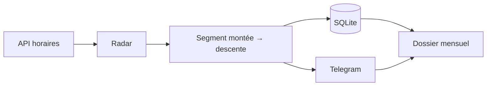

# Bazo

Radar TER Grand Est. **En service.**

Cinq processus Linux, redémarrés par systemd :

| Processus | Job |
|---|---|
| `bazo-radar` | scan horaires, retards ≥ 10 min, suppressions |
| `bazo-bot` | Telegram : profil, alerte, PDF |
| `bazo-api` | FastAPI — app / PWA |
| `bazo-mobile` | appli |
| `bazo-temps-reel` | fusion SNCF / CFL, reports, grève |

L'usager n'est alerté que si le train passe par **sa** montée et **sa** descente, dans **son** créneau. Le dossier mensuel (PDF + texte) part dans le formulaire Garantie Fiabilité.

Quota API quotidien. Rotation des axes. Pas de liste de gares en dur : le segment se calcule sur le profil.

Service tiers, non affilié SNCF. Sillon lorrain et axes voisins.

Ce dossier est la vitrine. Pas le code de production, pas la base, pas les jetons. Variables vides dans `.env.example`.
