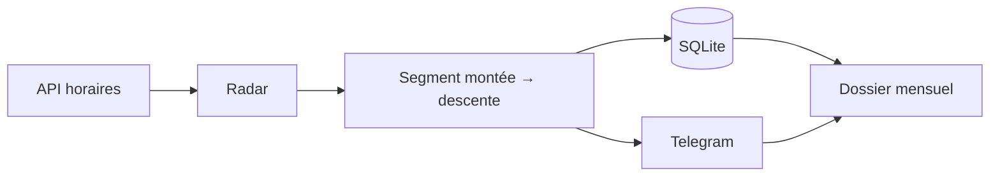

# Bazo

Radar TER Grand Est. **En service.**

Cinq processus Linux, redémarrés par systemd :

| Processus | Job |
|---|---|
| `bazo-radar` | scan horaires, retards ≥ 10 min, suppressions |
| `bazo-bot` | Telegram : profil, alerte, PDF |
| `bazo-api` | FastAPI — app / PWA |
| `bazo-mobile` | appli |
| `bazo-temps-reel` | fusion SNCF / CFL, reports, grève |

L'usager n'est alerté que si le train passe par **sa** montée et **sa** descente, dans **son** créneau. Le dossier mensuel (PDF + texte) part dans le formulaire Garantie Fiabilité.



```bash
python3 -m venv .venv && source .venv/bin/activate
pip install -r requirements.txt
cp .env.example .env
# remplir les jetons, valeurs vides ici
uvicorn bazo_api.main:app --host 127.0.0.1 --port 8080
```

PWA : `/app/`. Client Flutter : [../bazo-mobile](../bazo-mobile/). Tests : `python3 tests_parcours_critique.py`.

Service tiers, non affilié SNCF. Sillon lorrain et axes voisins. Pas de base ni de jetons dans ce dépôt.
