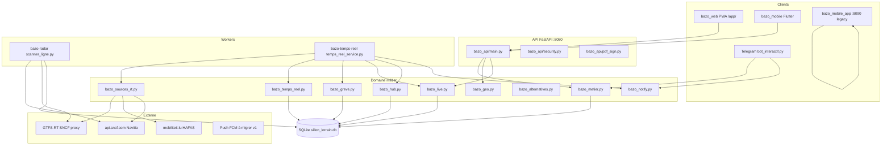

# Bazo — Architecture complète (brief Aragon)

Document de référence pour construire les apps **iOS / Android** (ou toute autre UI) sans relire tout le VPS.  
Base SQLite locale (jamais dans Git). Région cible : **Grand Est**, axe **Sillon Lorrain** (Nancy → Metz → Luxembourg).

---

## 1. Vue d’ensemble

Bazo suit les TER sur le Sillon Lorrain : **temps réel**, **check-in / check-out**, **attestation PDF** (Garantie Fiabilité), **signalements** voyageurs, **grève**, **hub d’entraide** (covoiturage de dépannage), **alertes Telegram**.



---

## 2. Processus systemd (production)

| Service | Commande | Port | Rôle |
|---------|----------|------|------|
| `bazo-bot` | `python -u bot_interactif.py` | — | Telegram : inscription, check-in, PDF, signalement |
| `bazo-radar` | `python -u scanner_ligne.py` | — | Scan axes, `historique`, alertes profil, snapshot théorique |
| `bazo-api` | `uvicorn bazo_api.main:app --host 0.0.0.0 --port 8080` | **8080** | **API officielle apps** + montage PWA `/app/` |
| `bazo-mobile` | `uvicorn bazo_mobile_app:app --port 8090` | 8090 | Legacy email/mot de passe (à fusionner ou déprécier) |
| `bazo-temps-reel` | `python -u temps_reel_service.py` | — | Cycle ~120 s : fusion GTFS+CFL+Navitia, grève, live map |

Fichiers unit : `/etc/systemd/system/bazo-*.service`, modèle temps réel : `deploy/bazo-temps-reel.service`.

---

## 3. Couches logicielles

### 3.1 Configuration — `bazo_config.py`

- Lit `.env` (jamais commiter) : `BAZO_TOKEN_TELEGRAM`, `BAZO_TOKEN_SNCF`, `BAZO_DB_PATH`, `MOBILITEIT_API_KEY`, etc.
- `db_connect()` → SQLite WAL, timeout configurable.
- `API_BASE_URL`, `API_REQUIRE_AUTH`, quotas via `bazo_quota.py`.

### 3.2 Métier central — `bazo_metier.py` (~2000 lignes)

- **Utilisateurs** : `inscriptions`, `charger_utilisateur`, profil aller/retour, créneaux 2 h.
- **Trajets** : `trajets_valides` (check-in, validation checkout, statuts `valide_*`, `valide_report` pour changement de train).
- **PDF** : `assembler_incidents_pdf`, règles **R1–R9** (voir `docs/PROJET_SUITE.md` §2).
- **Signalements phase 2** : tables `signalements`, `signalements_votes`, taxonomie, promotion vers PDF avec `provenance`.
- **Radar** : propositions, sync retard/suppression (ne doit pas écraser un `valide_report`).

### 3.3 Géographie — `bazo_geo.py`

- UIC canoniques Grand Est, axes radar (`trajets_radar`), `uic_pour_gare`, `nom_pour_uic`.
- Source unique pour bot, API, scanner, live map.

### 3.4 Temps réel multi-sources — `bazo_sources_rt.py`

| Source | Fonction | Usage |
|--------|----------|--------|
| SNCF GTFS-RT | `lire_gtfs_rt()` | protobuf ~780 KB, arrêts SKIPPED, annulations |
| CFL | `lire_cfl_board()` | Bettembourg / Luxembourg, clé `MOBILITEIT_API_KEY` |
| Navitia | `lire_navitia_train()` | complément ciblé (quota) |
| Fusion | `fusionner_sources()` | **le plus défavorable gagne** |

### 3.5 Moteur impacts — `bazo_temps_reel.py`

- Tables : `etats_trains`, `evenements_trains`, `alertes_temps_reel`, `suivi_immobilisation`, `reports_trajet`, `trains_habituels`.
- **Suppression partielle** : terminus effectif ≠ prévu.
- **Bascule auto** : `trouver_remplacant` → `reports_trajet`, statut `valide_report`.
- **Faux maintenu** : train ≥15 min immobile + train suivant plus tôt.
- **Retard cumulé** : arrivée réelle train 2 − arrivée prévue train 1.

### 3.6 Carte accueil — `bazo_live.py`

- `construire_snapshot(finals)` → tronçons `fluide` / `retard` / `supprime`, positions trains.
- Persisté dans `memoire_radar` clé `live_sillon` par `temps_reel_service`.
- `prochain_train`, `vue_usager` pour le tiroir mobile.

### 3.7 Grève — `bazo_greve.py` + `bazo_alternatives.py`

- Plan `greve_plan` / `greve_meta` / `greve_import`.
- Comparaison base_schedule vs realtime ; import grille SNCF ; `/montrain` + `trains_habituels`.
- Alternatives : train précédent / suivant **réellement circulant** + ETA destination.

### 3.8 Hub entraide — `bazo_hub.py`

- Ouverture sur suppression / retard / quorum « je suis bloqué ».
- Covoiturage : offres, réservations, plafond frais, pas de géoloc.

### 3.9 Notifications — `bazo_notify.py`

- Point unique Telegram pour modules temps réel / grève.
- `BAZO_ALERTES_TEMPS_REEL=1` pour envoi réel ; sinon log seulement.
- `BAZO_SIMULATION=1` pour tests (liste `MESSAGES_SIMULES`).

### 3.10 Bot Telegram — `bot_interactif.py` (~4300 lignes)

- Check-in : `recuperer_trains_theoriques` (pagination créneau, départs/arrivées, trains supprimés visibles).
- Commands : `/trajet`, `/montrain`, `/statut`, signalement tunnel `sig_`, PDF.
- Partage logique métier avec API via imports directs.

### 3.11 Radar — `scanner_ligne.py` (~1400 lignes)

- Boucle axes `bazo_geo`, Navitia + GTFS-RT, écrit `historique`, alertes créneau profil.
- Snapshot `horaires_theoriques_jour` (commit par axe anti-lock SQLite).

### 3.12 Cycle service — `temps_reel_service.py`

```
GTFS + CFL (+ Navitia ciblé) → fusionner_sources
→ mettre_a_jour_etats → notifier_impacts | faux_maintenus | suivre_reports
→ veille_greve → sauver_snapshot (live)
→ deduire_trains_habituels (après 03h)
```

---

## 4. API REST principale (`bazo_api/main.py`)

**Auth apps** : `Authorization: Bearer <api_token>` (token = colonne `inscriptions.api_token`, obtenu via `/token` sur Telegram).  
**Anti-IDOR** : la plupart des routes exigent que le token corresponde à `{id_telegram}` dans l’URL (`require_user`).

Spec machine : **`docs/openapi.json`** (OpenAPI 3.1).

### 4.1 Parcours voyageur (priorité mobile)

| Méthode | Route | Rôle |
|---------|-------|------|
| GET | `/v1/auth/check` | Valider token |
| GET | `/v1/profil/{id}` | Profil |
| PUT | `/v1/profil/{id}` | Mise à jour profil |
| GET | `/v1/trains/{id}?sens=aller\|retour` | Liste trains créneau (Navitia base) |
| POST | `/v1/checkin` | Déclarer trajet |
| GET | `/v1/checkout/pending/{id}` | Trajets à confirmer |
| POST | `/v1/checkout/{trajet_id}` | Check-out (retard réel) |
| GET | `/v1/statut/{id}` | Bilan GF mois courant |
| GET | `/v1/incidents/{id}` | Historique incidents |
| GET | `/v1/live/sillon` | **Carte publique** (sans auth) |
| GET | `/v1/live/{id}` | **Accueil** : réseau + prochain train + pdf flag |
| GET | `/v1/pdf/mois/{id}` | Mois éligibles |
| POST | `/v1/pdf/{id}/link?mois=` | Lien signé PDF |
| GET | `/v1/pdf/download?token=` | Téléchargement PDF |
| GET | `/v1/habituels/{id}` | Trains habituels |
| POST | `/v1/habituels/{id}` | Définir train habituel |
| GET | `/v1/greve/{id}` | Plan grève personnalisé |

### 4.2 Signalements (phase 2)

| Méthode | Route |
|---------|-------|
| GET | `/v1/signalements/types` |
| POST | `/v1/signalements` |
| GET | `/v1/trains/{date}/{numero}/signalements` |
| POST | `/v1/signalements/{id}/vote` |
| POST | `/v1/signalements/{id}/trajet` |

### 4.3 Hub entraide

| Méthode | Route |
|---------|-------|
| GET | `/v1/hub/{id}` |
| POST | `/v1/hub/{id}/bloque` |
| POST | `/v1/hub/{id}/offres` |
| POST | `/v1/hub/{id}/offres/{offre_id}/reserver` |
| … | statut, abus, annulation |

### 4.4 Géo / admin / RGPD

- `/v1/geo/*`, `/v1/tgv/radar`, `/v1/admin/*`, `/v1/account/{id}/export`, `/v1/devices/{id}` (push).

---

## 5. Modèle de données (SQLite)

Tables principales :

| Table | Contenu |
|-------|---------|
| `inscriptions` | Profil, créneaux, `api_token`, alertes |
| `trajets_valides` | Check-in, statut, retards, `provenance`, `retard_cumule_min` |
| `historique` | Événements radar (retard/suppression) |
| `horaires_theoriques_jour` | Référence théorique par axe/jour |
| `surveillance_trains` | Trains suivis après check-in |
| `signalements` / `signalements_votes` | Signalements unifiés |
| `etats_trains` / `evenements_trains` | Temps réel fusionné |
| `reports_trajet` | Changement de train, retard cumulé |
| `trains_habituels` | `/montrain`, grève ciblée |
| `greve_plan` / `greve_meta` / `greve_import` | Grève |
| `hubs` / `hub_offres` / … | Entraide |
| `memoire_radar` | État service, **`live_sillon`**, quotas, clés grève |
| `device_tokens` | Push mobile |

Schéma détaillé : exporter avec `sqlite3 sillon_lorrain.db .schema` (ne pas versionner la DB prod).

---

## 6. Clients UI

### 6.1 PWA recommandée — `bazo_web/`

| Fichier | Rôle |
|---------|------|
| `index.html` | Shell : onboard + 5 onglets (accueil, trajet, fil, entraide, moi) |
| `app.js` | **~530 lignes** : API client, **carte SVG 35 %**, sheet 65 %, trajet, hub, PDF |
| `app.css` | Thème sombre `#0F172A`, vert `#10B981`, ambre `#F59E0B`, rouge `#FF2D4A` |
| `manifest.json` | `start_url: /app/home.html` ou `/app/` selon version |
| `sw.js` | Cache PWA |

Montage : `bazo_api/main.py` → `app.mount("/app", StaticFiles(...))`.

**Écran accueil** : `GET /v1/live/{id}` → `dessinerCarte()`, `dessinerHero()`, refresh 30 s.

### 6.2 Flutter — `bazo_mobile/lib/`

- `bazo_api.dart` : client HTTP Bearer.
- `main.dart` : écrans Profil / Trains / Out / PDF / Statut (parité partielle avec PWA).
- **Cible Aragon** : reprendre **OpenAPI + PWA app.js** comme spec UX ; une seule API **8080**.

### 6.3 Legacy 8090 — `bazo_mobile_app.py`

- Auth email/password PBKDF2, routes `/api/v1/*` **différentes** de l’API 8080.
- À **ne pas dupliquer** pour une app propre : migrer vers 8080 + token Telegram.

---

## 7. Flux critiques (séquences)

### 7.1 Check-in mobile

1. `GET /v1/trains/{id}?sens=aller` → Navitia `base_schedule`, créneau profil.
2. `POST /v1/checkin` → insert `trajets_valides`, `activer_surveillance_checkin`.
3. Radar / temps réel qualifient le trajet sans créer de ligne PDF seule (R3).

### 7.2 Incident + changement de train

1. `temps_reel_service` détecte terminus anticipé ou annulation.
2. `enregistrer_report` + alerte (si `BAZO_ALERTES_TEMPS_REEL=1`).
3. PDF : motif « Arrêt à X : changement de train forcé », `valide_report`, `retard_cumule_min`.

### 7.3 Accueil temps réel

1. Worker écrit snapshot JSON dans `memoire_radar.live_sillon`.
2. App : `GET /v1/live/{id}` (<100 ms si PDF cache async).
3. Front anime trains sur tracé Bézier Nancy→Luxembourg.

---

## 8. Variables d’environnement (noms uniquement)

| Variable | Effet |
|----------|--------|
| `BAZO_DB_PATH` | Chemin SQLite (tests : copie `/tmp/...`) |
| `BAZO_API_REQUIRE_AUTH` | 1 = Bearer obligatoire sur API |
| `BAZO_ALERTES_TEMPS_REEL` | 1 = Telegram auto depuis notify |
| `BAZO_SIMULATION` | 1 = pas d’envoi Telegram réel |
| `MOBILITEIT_API_KEY` | CFL Bettembourg |
| `BAZO_TEMPS_REEL_INTERVALLE` | Secondes entre cycles (défaut 120) |
| `BAZO_API_DOCS` | 1 = `/docs` Swagger |

Ne jamais copier les valeurs dans la doc ni dans git.

---

## 9. Tests

| Fichier | Scope |
|---------|--------|
| `tests_parcours_critique.py` | 104 tests : API, PDF, geo, signalements, check-in |
| `tests_temps_reel.py` | 24 tests : fusion, grève, live, hub, Bettembourg 90 min |

Toujours : `BAZO_DB_PATH=/tmp/copie.db`, `BAZO_API_REQUIRE_AUTH=0` pour la suite parcours.

---

## 10. Arborescence code (fichiers à lire en priorité)

```
./
├── bazo_config.py          # env, DB
├── bazo_metier.py          # cœur métier + signalements + PDF
├── bazo_geo.py             # UIC, axes
├── bot_interactif.py       # Telegram
├── scanner_ligne.py        # radar
├── temps_reel_service.py   # worker temps réel
├── bazo_sources_rt.py      # GTFS, CFL, Navitia
├── bazo_temps_reel.py      # impacts, reports
├── bazo_live.py            # snapshot carte
├── bazo_greve.py           # grève
├── bazo_alternatives.py    # trains avant/après
├── bazo_hub.py             # entraide
├── bazo_notify.py          # Telegram sortant
├── bazo_greve_admin.py     # CLI opérateur
├── bazo_api/
│   ├── main.py             # FastAPI (1470 lignes)
│   ├── security.py         # auth, rate limit
│   └── pdf_sign.py         # tokens PDF
├── bazo_web/               # PWA accueil + onglets
├── bazo_mobile/lib/        # Flutter stub
├── deploy/bazo-temps-reel.service
├── docs/
│   ├── ARCHITECTURE_ARAGON.md   # ce fichier
│   ├── PROJET_SUITE.md          # spec produit R1–R9, hub, phases
│   ├── ARCHI_TEMPS_REEL_GREVE.md
│   └── openapi.json             # contrat API
└── tests_*.py
```

---

## 11. Recommandations pour Aragon (apps natives)

1. **Une seule backend** : `bazo_api` :8080 + `docs/openapi.json`.
2. **Auth** : Telegram ID + token Bearer (pas de second système 8090).
3. **Écran 1** : reproduire `bazo_web/app.js` accueil (carte + sheet) ; données = `/v1/live/{id}`.
4. **Écran 2** : check-in = `/v1/trains` + `/v1/checkin`.
5. **Push** : enregistrer via `POST /v1/devices/{id}` ; migrer `bazo_push.py` vers FCM HTTP v1.
6. **Offline** : cache dernier `live.reseau` + profil ; pas de logique métier en local.
7. **PDF** : toujours via `POST /v1/pdf/{id}/link` puis download token (ne pas regénérer côté client).

---
